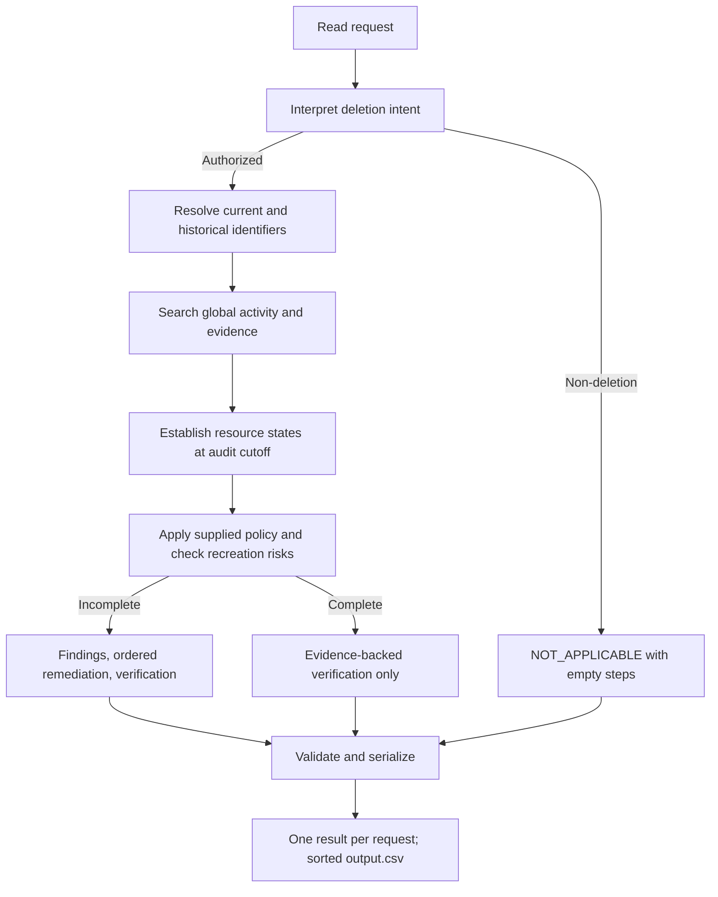

# Deletion-audit workflow specification

Status: design defaults accepted on 2026-10-25; scope tightened by the user's subsequent review. Implementation has not started. This revision replaces the broader infrastructure plan with the minimum workflow needed for the challenge.

Sources: [problem statement](../problem_statement.md), [repository guidance](../AGENTS.md), [README and evaluation instructions](../README.md), and [32 public sample exercises](public-samples/report.md). Supporting documents: [technical decisions](technical-decisions.md) and [acceptance-case catalog](workflow-acceptance-cases.md).

## 1. Goal and scope boundary

For every request in `dataset/deletion_requests.csv`, determine whether deletion was requested. For authorized requests, reconstruct current/historical identifiers, search global activity and evidence, establish state at `audit_at`, apply the supplied policy, and return the required decision and steps. Preserve retained records and permitted tombstone references.

The deliverable is a terminal application producing root-level `output.csv`, plus runnable code, required evaluation and usage reports, and the root development transcript. It does not execute deletion against live systems.

| Challenge requirement | Workflow responsibility | Evidence of success |
|---|---|---|
| Determine whether deletion was requested | Triage the request text, including multilingual and prior-deletion requests | Non-deletion gives NOT_APPLICABLE with [] |
| Recover current and historical identity | Exact identity/history matching and grounded aliases | Correct subject links; no unrelated records attached |
| Search global activity and evidence | Read CSV, SQL, JSON, logs, text, PDF and images through scoped tools | Relevant records and risks supported by public source IDs |
| Establish state at audit_at | Filter admissible evidence and compare resource observations | Claims are not treated as state proof; later evidence is excluded |
| Apply deletion policy | Determine record category and applicable condition | Correct delete/redact/anonymize/retain treatment |
| Explain incomplete deletion | Findings plus safe ordered remediation and future checks | All supported violations/risks and required obligations represented |
| Prove complete deletion | Evidence-backed verification only | Required states established, retained records preserved, recreation paths safe |
| Preserve tombstones correctly | Retain stable internal reference while removing prohibited identifiers | No wholesale deletion of a compliant tombstone |
| Produce evaluable output | Validate and serialize exact contract | 518 unique sorted rows, allowed statuses and ordered seven-field steps |
| Evaluate and report usage | Score public/custom cases and measure final-run calls/tokens/cost | Required Markdown reports inside code/evaluation/ |

Every implementation component must support one of these responsibilities. Do not build a general privacy platform, provider router, multi-agent coordinator, web service, live deletion executor, generic workflow engine, database migration system, or resume-management interface. A small evidence index/cache and local usage/result files are implementation aids, not additional product features.

## 2. Execution flow

The flow is sequential where conclusions depend on earlier stages. Independent evidence searches can run concurrently after identity resolution. New aliases, trace IDs or resource links can trigger further searches before finalization. Do not turn this bounded investigation into a general task-planning system.

Uncertain intent or unsupported material conclusions trigger a focused retry/investigation and, if unresolved, an explicit internal failure diagnostic. There is no fourth submission status. A failed lookup does not prove absence; a missing identity does not mean NOT_APPLICABLE. Do not silently omit cases or manufacture steps to satisfy row counts. Completing all 518 valid rows remains the final-run exit criterion.

## 3. Use of OpenAI Agents SDK

Use Python 3.14.5 already installed on the user's system, with uv for the project environment. OpenAI is the sole model provider. The Agents SDK supplies the bounded model/tool loop, typed outputs and usage collection; ordinary Python owns stage order, cutoff enforcement, policy checks and serialization.

Use two sequential task configurations, not a multi-agent organization:

1. **Request triage:** a short structured-output run using only the request text/metadata, returning intent and supporting request spans. It has no evidence-search tools. A clearly non-deletion request stops here.
2. **Deletion audit:** an authorized-case run with resolved identifiers, the supplied policy, and read-only evidence tools. It may request more relevant evidence and returns a structured assessment with resource observations, links, policy decisions and proposed steps.

There are no handoffs, worker-agent delegation or summarization agent. The audit output is a proposal: deterministic code validates its evidence, applicable policy and output structure, assembles canonical ordering, and rejects unsupported references. Relevant PDF/image interpretation can use the same configured OpenAI model when supported; count any separate model calls in usage.

Only the model identifier and cost/run limits remain to be selected before live calls. Do not assume this coding chat's model is available through the participant's API credentials.

## 4. Minimal case state

Keep a typed in-memory case context, with only the records required to produce and explain the answer:

| State | Contents |
|---|---|
| Request | case ID, request text/email, request/report/cutoff times |
| Authorization | intent, supporting spans, any unresolved ambiguity |
| Identity | accepted subject, current/historical typed identifiers, supporting audit/snapshot links |
| Observations | resource/system/copy, observed fields/state, observation time, source capture time, file/activity/audit ID and locator |
| Relationships | grounded subject-resource, trace, replica, source/downstream and process links |
| Policy/obligations | category, applicable rule/condition, required final state, violations and retained-record checks |
| Result/usage | validated steps or diagnostic; actual model requests, token usage and estimated cost |

Subject ownership, observed state, policy applicability and time admissibility are distinct facts. A record with null identifiers may be anonymous without being attributable to the current case. Store several supporting references internally even though each output step has one evidence_id.

Optional caching may avoid parsing the same artifact or repeating an identical successful call. Cache keys include the source hash and parser/prompt/model settings; any case-dependent cache also includes cutoff and identity scope. Save completed results and usage for reproducibility, without building generic checkpoint revisions, migration tables or a dedicated resume CLI.

## 5. Read-only evidence tools

Use normal Python functions wrapped as SDK function tools where needed. Tools return facts/provenance, not unsupported verdicts; they cannot modify dataset files or delete records.

| Tool responsibility | Input | Output |
|---|---|---|
| Resolve identity/history | Request email, cutoff | Subject candidates and current/historical alias links |
| Search evidence | Typed identifiers/resources, case cutoff | Exact matching fragments, source IDs, locations and search limits |
| Read artifact | Manifest file ID and page/record/region | Content or extracted observations with provenance |
| Trace related records/activity | Grounded resource/trace identifiers, cutoff | Related observations and explicit relationship evidence |
| Read policy | Resource category and known conditions | Supplied rules and condition requirements |

Return errors, truncated searches and successful empty results distinctly. Exhaust required pages or report incomplete coverage. A manifest locates an artifact; its contents establish membership. Exact identifier boundaries prevent user_48 matching user_480. Do not use filenames, list positions, adjacent event times, or resource prefixes as ownership shortcuts.

Index participant data only. Public expected answers are read by evaluation after predictions are frozen; neither expected answers nor analysis reports are runtime evidence. Do not inspect organizer-only truth or generator internals for predictions.

## 6. Evidence, time and policy rules

- File evidence must be captured at or before audit_at; any explicit observation used must also be at or before cutoff. Equality is permitted. Under the current AGENTS.md rule, a later export cannot provide an earlier case's state or identity bridge merely because it contains older events.
- Activity/history rows use their supplied event times; current identity snapshots use their update time. Unknown times remain unknown. Retrieval filters before returning model context or joining identities.
- Reported workflow status and operation success/failure are claims. Readbacks, snapshots, configuration and business-artifact contents must support the resulting state within their stated scope.
- Compare observations by physical copy and time. Primary absence cannot overwrite replica presence. Old presence does not automatically prove continued presence, and a newer success claim does not automatically prove removal.
- No search hit, parse failure, query error or empty partial snapshot is not absence proof. A complete scoped lookup/snapshot can support absence, but cannot invent a missing resource ID.
- Match aliases and hashes through supplied data. Identifier reuse or ambiguous matches require corroboration. The user explicitly approved ASCII email case equivalence on 2026-10-25: preserve originals and reject normalized cross-subject collisions. Do not manufacture phone country codes, hash algorithms, provider-specific dot/plus aliases, Unicode mailbox equivalence, or other email equivalence rules.
- Apply deletion_rules.csv conditions to grounded record categories. A service/resource name is not a policy category. A false retention condition does not itself create an unspecified DELETE rule.
- A tombstone may keep the stable subject reference; remove prohibited name, email, phone, email hash and any other identifiers required by the rule. Preserve other policy-required records.
- Evaluate active flows and restore access even when account records are absent. Disable/block recreation paths before dependent remediation; preserve required backup archives.

## 7. Decision and output assembly

NOT_APPLICABLE means a supported non-deletion request and exactly []. COMPLETE requires compliant relevant copies, required retained records present, and no active prohibited recreation path, with evidence-backed verification only. INCOMPLETE requires supported findings, a complete safe plan, and checks for all required final states, including retained resources not needing repair.

Output columns are exactly case_id,deletion_status,steps_json. Steps contain exactly step_no,phase,system_id,resource_id,operation,state,evidence_id. Load the allowed operation/state pairs and canonical operation order from the challenge contract into a small fixed registry.

Order findings, remediation, verification; within phase use the prescribed operation rank, then system_id and resource_id. Check any grounded remediation dependencies against that order. Do not invent dependency edges from names. A genuine conflict is a contract diagnostic, not permission to silently violate either rule.

Findings and COMPLETE verification cite an admissible public file_id/activity_id/audit_id. INCOMPLETE remediation and verification have empty evidence_id. Deduplicate repeated observations of a logical obligation while retaining copy-level proof; do not collapse distinct resources. Validation checks cited IDs, supporting subject/state links, timestamps, policy conditions, step shape, sequence and coverage. Schema validation alone is not proof of semantic correctness.

Write the final output only after the complete requested case set validates. Internal diagnostics are debugging information, not extra submission columns, labels or operations. The known sample provenance gaps remain investigation issues; do not hardcode public-answer resource references to hide them.

## 8. Required evaluation and usage reporting

Implement evaluation in code/evaluation/main.py. Canonical source reports are code/evaluation/evaluation_report.md and code/evaluation/usage_report.md, as explicitly required by README's Evaluation section. Keep custom-case definitions and expected outcomes reviewable there, using source/Markdown rather than only raw JSON/CSV files that the judge ignores.

The evaluation report must contain:

- Case-level deletion-status accuracy over all labeled cases.
- Step-level accuracy/precision/recall with matching rules and denominators stated.
- Field-level accuracy with deterministic alignment and penalties for missing/extra steps.
- Exact ordered-sequence accuracy after parsing JSON; key order/whitespace ignored, array order preserved.
- At least three participant-created cases with expected result, actual result and explanation.
- Failures found and improvements made, including unresolved evidence issues without disguising them as successful predictions.

Use the 32 public samples as a development/regression set and add at least A01–A03 from the acceptance catalog. Add other targeted tests when the implementation needs them; the 22-case catalog is not a mandatory new product scope. Keep prediction separate from expected-answer scoring. No hidden-label accuracy claim can be made for the 518 evaluation requests.

The usage report must summarize the final full-dataset run that produced output.csv: OpenAI model names, model-call counts, input/output/total tokens, average tokens per request, estimated total/per-request cost, and per-model plus overall totals if multiple models are used. Include triage, audit, visual calls and reported retries; do not count tool invocations as separate model calls or double-count aggregate/per-call SDK usage. Shared extraction cost and any reused model-result cache attribution must be explained. Unknown usage is unavailable, not zero. Record the price assumptions used for estimates.

README names code/evaluation/ while AGENTS.md and the problem statement also require evaluation/ paths in code.zip. Keep one authoritative pair of source reports in code/evaluation/ and have packaging include identical generated copies at archive-root evaluation/. This satisfies both path contracts without maintaining two reports manually. Exclude dataset, caches, environments, nested archives and secrets; include runnable code, prompts/configuration and clear setup/run instructions. Root log.txt is the separate chat_transcript artifact.

## 9. Implementation plan and scope guard

1. **Foundation:** Python 3.14.5 environment, minimal entry point, typed schemas, operation registry, output validation and A01–A03 fixtures.
2. **Evidence:** participant-file loaders, current/historical identity resolution, exact lookup, timestamp filtering and provenance; PDF/image support needed by supplied evidence.
3. **Agent integration:** OpenAI Agents SDK triage/audit configurations, read-only tools, typed results, bounded retries/turns and usage capture. Validate actual SDK compatibility on Python 3.14.5.
4. **End-to-end audit:** reconstruct state, apply policy, build/validate steps; run and inspect all 32 samples; improve only based on observed failures and required contract cases.
5. **Evaluation and delivery:** run custom cases, write measured evaluation, process all 518 requests, validate output, write final-run usage report and package required artifacts.

Do not spend implementation effort on generic migrations, multi-provider adapters, distributed orchestration, database services, interactive approval flows, telemetry dashboards, autonomous code improvement, deployment infrastructure, or behavior outside the supplied policy. Local caching, limited concurrency and diagnostics are justified only where they make the required run correct and practical.

Remaining contract questions are limited to actual evidence-link gaps, later-file admissibility, unsupported repair vocabulary for missing retained records, and any real ordering conflicts. Keep them visible and investigate affected cases; do not build new operations or a broader policy engine to solve hypothetical scenarios.

## User-approved candidate publication amendment (2026-10-25)

The failure gate prevents unsupported evidence certification, rather than halting
implementation or batch processing. Structural output validation and semantic
source/policy/coverage validation are separate. Candidate mode processes every
request, retains independently grounded treatments, and records unresolved
conditions in internal diagnostics and the evaluation report. Unknown retention
periods and exclusive ownership are never supplied by default or inferred solely
from a subject match. Unsupported cases receive explicitly documented candidate
limitations; INCOMPLETE with no steps is an uncertified fallback, not a finding.
Only cases passing the complete existing semantic checks are evidence-validated.
The three-status CSV contract has no uncertainty value, so diagnostic counts and
output hashes must accompany any candidate file. Do not describe candidate row
coverage as full evidence validation or accuracy. Strict certification remains
available without --candidate.
